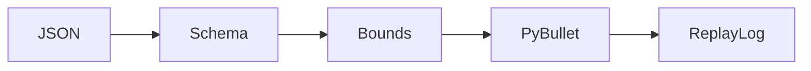

1. Reject malformed and out-of-workspace model actions before a simulator executes them.

2. Result:
   Invalid actions rejected: 1004  
   Unsafe acceptance rate after validation: 0.0  
   Replay records reproduced: 1024  

   Measured by `make bench`; raw [results](evidence/bench.json), [checks](evidence/checks.log), and [environment](evidence/environment.json).

3. Architecture:


4. Run it (from this folder):
```sh
make setup
make lint test bench
PYTHONPATH=src ../../.venv/bin/python src/validator.py --replay evidence/replay.jsonl
```

5. Decisions and limits: Synthetic actions only; strict schema and finite coordinate bounds. PyBullet dry run uses a kinematic point robot, not collision planning or a hardware safety certification. Baseline passes every malformed input through (failure rate in bench.json); the guarded path rejects them. The recorded gate-failure.log demonstrates that unsafe baseline failing the same corpus. Replay compares accepted positions and rejected decisions. Coverage is for this seeded corpus, not all possible inputs.

6. Next: Add articulated arm collision checks and simulator-version migration tests.
