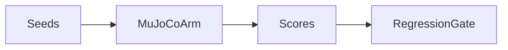

1. Catch control-policy regressions with repeatable MuJoCo arm scenarios.

2. Result:
   Policy versions evaluated: 3  
   Best policy successes: 30  
   Episodes per policy: 30  

   Measured by `make bench`; raw [results](evidence/bench.json), [checks](evidence/checks.log), and [environment](evidence/environment.json).

3. Architecture:


4. Run it (from this folder):
```sh
make setup
make lint test bench
../../.venv/bin/python src/harness.py --gate
```

5. Decisions and limits: An original open single-joint arm task is included as XML; no downloaded robot assets. Fixed seeds and simulator version reproduce scores locally. Cross-platform floating-point bit identity is not guaranteed. The gate requires success rate >=0.9. Recorded failing baseline is evidence/gate-failure.log. A failing GitHub PR is required separately for full acceptance.

6. Next: Add multi-joint contact tasks and cross-platform tolerance analysis.
